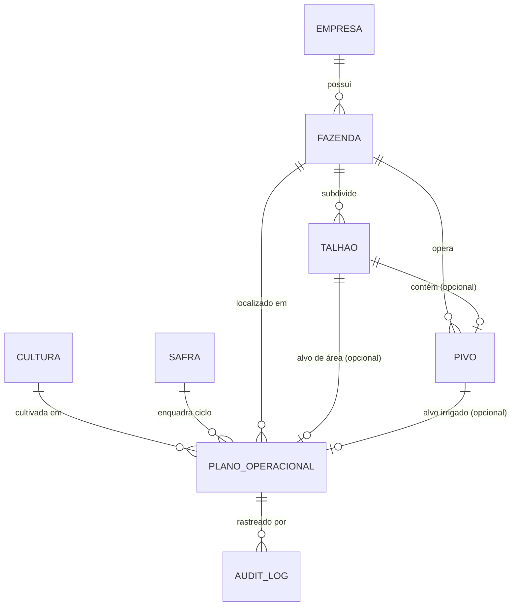

# Fase 4.1 — Módulo de Planejamento Agrícola do Cockpit de Pivôs

Este documento descreve a implementação técnica de ponta a ponta do **Módulo de Planejamento Agrícola**, integrando a estrutura fundiária, catálogo de culturas, safras agrícolas, planos de cultivo por área/pivô, calendário interativo, indicadores agronômicos, aplicativo móvel offline-first e trilha de auditoria.

---

## 1. Arquitetura e Modelo de Dados

O planejamento agrícola apoia-se em uma hierarquia fundiária e operacional estrita:
**Empresa** ➔ **Fazenda** ➔ **Talhão** e/ou **Pivô Central** ➔ **Plano Operacional de Cultivo** (associado a uma **Safra** e a uma **Cultura**).



### 1.1 Entidades Principais

| Entidade | Aplicação Django | Tabela DB | Descrição |
| :--- | :--- | :--- | :--- |
| **`Empresa`** | `apps.pivots` | `empresas` | Organização/holding proprietária das unidades agrícolas. Suporta isolamento multi-empresa. |
| **`Fazenda`** | `apps.pivots` | `fazendas` | Unidade agrícola com localização geográfica, área total e vínculo com empresa. |
| **`Talhao`** | `apps.pivots` | `talhoes` | Área física produtiva delimitada em hectares (`area_ha`). |
| **`Pivo`** | `apps.pivots` | `pivos` | Equipamento mecanizado de irrigação circular ou setorial, com raio, vazão e área irrigada (`area_irrigada_ha`). |
| **`Cultura`** | `apps.operations` | `culturas` | Catálogo de espécies vegetais (Soja, Milho, Feijão, Algodão, Trigo, Café) com ciclo estimado em dias e consumo hídrico de referência. |
| **`Safra`** | `apps.operations` | `safras` | Ciclo temporal agrícola com datas de início e término (`data_inicio`, `data_fim`), situação (`PLANEJAMENTO`, `EM_ANDAMENTO`, `ENCERRADA`) e vínculo com fazenda/empresa. |
| **`PlanoOperacional`** | `apps.operations` | `planos_operacionais` | Vínculo entre Safra, Cultura, Fazenda, Talhão e/ou Pivô, datas planejadas de plantio/colheita, área planejada (ha) e situação. |
| **`AuditLog`** | `apps.core` | `audit_logs` | Trilha de auditoria com usuário, ação (`CRIOU_PLANO`, `ATUALIZOU_PLANO`, `TRANSICAO_STATUS_PLANO`, `CANCELOU_PLANO`), IP e payload JSON com detalhes. |

---

## 2. Regras de Negócio e Validações

### 2.1 Validação Temporal
1. **Safra:** `data_fim` deve ser estritamente maior ou igual a `data_inicio`. Safras não precisam corresponder obrigatoriamente a um ano civil (ex: safras de inverno ou ciclos bianuais).
2. **Plano de Cultivo:**
   - `data_colheita_prevista` deve ser maior ou igual a `data_plantio`.
   - `data_plantio` e `data_colheita_prevista` devem estar dentro da janela da Safra selecionada (`safra.data_inicio` a `safra.data_fim`).

### 2.2 Validação de Área e Unidades de Medida
- Toda área é manipulada estritamente em **hectares (ha)** com 2 casas decimais (`DecimalField`).
- `area_planejada_ha` deve ser estritamente maior que zero (`> 0.00`).
- Quando associado a um **Talhão**, a área planejada não pode exceder a área cadastrada do talhão (`area_planejada_ha <= talhao.area_ha`).
- Quando associado a um **Pivô**, a área planejada não pode exceder a área irrigada máxima do equipamento (`area_planejada_ha <= pivo.area_irrigada_ha`).

### 2.3 Coerência e Isolamento Fundiário
- O Talhão e/ou Pivô informado no plano deve obrigatoriamente pertencer à mesma **Fazenda** vinculada ao plano.
- A Safra selecionada deve pertencer à mesma Fazenda do plano (ou não possuir restrição de fazenda se for corporativa da mesma Empresa).
- Usuários com acesso restrito a determinadas fazendas visualizam e operam apenas planos pertencentes a essas fazendas.

### 2.4 Máquina de Estados e Transições do Planejamento

Os planos de cultivo operam sobre a seguinte máquina de estados finitos:

```
[RASCUNHO] ──► [PLANEJADO] ──► [EM_ANDAMENTO] ──► [CONCLUIDO]
     │              │                 │
     ▼              ▼                 ▼
[CANCELADO]    [CANCELADO]       [CANCELADO]
```

* Matriz de transições permitidas:
  * `RASCUNHO` ➔ `PLANEJADO`, `CANCELADO`
  * `PLANEJADO` ➔ `EM_ANDAMENTO`, `RASCUNHO`, `CANCELADO`
  * `EM_ANDAMENTO` ➔ `CONCLUIDO`, `CANCELADO`
  * `CONCLUIDO` ➔ Estado final (não permite transições)
  * `CANCELADO` ➔ Estado final (pode retornar a `RASCUNHO` sob justificativa auditada)
* Todas as transições são protegidas pelo endpoint `/api/v1/operations/planos/{id}/transicionar-status/` e gravadas no `AuditLog`.

---

## 3. Endpoints da API REST (`/api/v1/`)

| Método | Endpoint | Descrição | Perfis Autorizados |
| :--- | :--- | :--- | :--- |
| `GET, POST` | `/api/v1/pivots/empresas/` | Listagem e cadastro de empresas | Todos (GET), Admin/Gestor (POST) |
| `GET, POST` | `/api/v1/pivots/talhoes/` | Listagem e cadastro de talhões | Todos (GET), Admin/Gestor (POST) |
| `GET, POST` | `/api/v1/operations/culturas/` | Catálogo de culturas agrícolas | Todos (GET), Admin/Gestor (POST) |
| `GET, PUT, PATCH, DELETE` | `/api/v1/operations/culturas/{id}/` | Detalhe, alteração e desativação | Todos (GET), Admin/Gestor (PUT/DEL) |
| `GET, POST` | `/api/v1/operations/safras/` | Safras e ciclos agrícolas | Todos (GET), Admin/Gestor (POST) |
| `GET, PUT, PATCH` | `/api/v1/operations/safras/{id}/` | Detalhe e edição de safra | Todos (GET), Admin/Gestor (PUT) |
| `GET, POST` | `/api/v1/operations/planos/` | Listagem paginada e criação de planos | Todos (GET), Admin/Gestor/Operador (POST) |
| `GET, PUT, PATCH, DELETE` | `/api/v1/operations/planos/{id}/` | Detalhes, alteração e exclusão lógica | Todos (GET), Admin/Gestor/Operador |
| `POST` | `/api/v1/operations/planos/{id}/transicionar-status/` | Transição de estado com justificativa | Admin, Gestor, Operador |
| `GET` | `/api/v1/operations/planos/calendario/` | Eventos de plantio/colheita para cronograma | Todos autenticados |
| `GET` | `/api/v1/operations/planos/indicadores/` | Indicadores consolidados em tempo real | Todos autenticados |
| `GET` | `/api/v1/operations/planos/{id}/historico-auditoria/` | Trilha de auditoria específica do plano | Todos autenticados |
| `GET` | `/api/v1/sync/pull/` | Carga de catálogo completa para mobile (inclui planos, safras, culturas, talhões, empresas) | Todos autenticados |
| `POST` | `/api/v1/sync/push/` | Recepção de lote idempotente (inclui operações `entity="plano"`) | Admin, Gestor, Operador |

---

## 4. Frontend Web

O frontend web é desenvolvido em React / TypeScript com Tailwind CSS e TanStack Router.

### 4.1 Telas e Componentes
1. **`/planejamento` (Hub Central):**
   - Abas integradas: **Planos de Cultivo**, **Cronograma & Calendário**, **Indicadores & Métricas**, **Catálogo de Culturas**, **Safras & Ciclos**, **Estrutura Fundiária**.
2. **Listagem de Planos (`PlanListView`):**
   - Busca em tempo real por cultura, safra, fazenda, talhão e pivô.
   - Filtros combinados por safra, fazenda, cultura e situação.
   - Paginação e ordenação por data de plantio.
   - Ações rápidas: visualizar detalhes, transicionar status com modal de confirmação, editar e cancelar.
3. **Formulário de Criação/Edição (`PlanFormModal`):**
   - Seleção reativa de Fazenda, com recarregamento dinâmico dos Talhões e Pivôs pertencentes.
   - Seleção de Safra com apresentação automática do período limite da safra.
   - Seleção de Cultura com pré-cálculo da data de colheita estimada baseada no ciclo (`dias_ciclo_estimado`).
   - Validações em tempo real de consistência de datas e limites de área.
4. **Detalhes do Planejamento (`PlanDetailModal`):**
   - Resumo técnico de área, datas, alvo (pivô ou talhão), progresso estimado do ciclo e consumo hídrico estimado.
   - Trilha completa de auditoria com histórico de modificações, autor e horário.
5. **Visão de Calendário (`PlanningCalendar`):**
   - Linha do tempo visual de 12 meses (Gantt) destacando o intervalo do ciclo de cultivo e marcadores de plantio e colheita.
   - Filtros instantâneos por safra, cultura, fazenda e situação.
6. **Indicadores do Planejamento (`PlanningIndicators`):**
   - Cards com total de planos, área planejada total (ha), planos em andamento e taxa de conclusão.
   - Distribuição de área por cultura e por situação.
   - Tabela de próximos plantios previstos.
7. **Cadastros Auxiliares:**
   - `CropCatalogView`: Gestão de espécies vegetais.
   - `SeasonManagementView`: Gestão de safras e ciclos.
   - `AgriculturalStructureView`: Gestão de Fazendas, Talhões e Empresas.

---

## 5. Aplicativo Mobile (React Native / Expo)

O aplicativo móvel foi projetado para uso operacional em campo, mesmo sem conexão à internet.

### 5.1 Recursos
- **Aba "Planejamento":**
  - Lista planos agrícolas autorizados diretamente do armazenamento local (`LocalDatabase`).
  - Filtros rápidos por situação (`Todos`, `Planejado`, `Em Curso`, `Concluído`) e busca por texto.
  - Indicador de status de sincronização (ex: "X operação(ões) pendente(s)" ou "Base local sincronizada").
- **Visualização de Detalhes em Campo:**
  - Informações completas de cultura, safra, fazenda, talhão, pivô, área e datas.
- **Transições de Status Operacionais em Campo:**
  - Operadores podem iniciar o plantio ("🌱 Iniciar Plantio") e concluir o ciclo ("🌾 Concluir Colheita") diretamente pelo app.
  - O aplicativo atualiza o registro local imediatamente e enfileira a operação na **Outbox Queue** com `client_op_id` idempotente.
- **Sincronização Bidirecional Idempotente:**
  - Ao recuperar sinal ou acionar o botão "Sincronizar":
    1. O lote pendente é transmitido via `/api/v1/sync/push/`.
    2. O servidor processa e registra cada operação na tabela `ProcessedOperation` para evitar duplicidades.
    3. O catálogo atualizado (planos, culturas, safras, talhões) é baixado via `/api/v1/sync/pull/` e atualizado na base local.

---

## 6. Comandos e Testes

### 6.1 Executar Migrations
```powershell
cd d:\Cockpit_de_Pivos\backend
.\venv\Scripts\python.exe manage.py migrate
```

### 6.2 Carga de Dados Demonstrativos (Idempotente)
```powershell
.\venv\Scripts\python.exe manage.py seed_planejamento
```

### 6.3 Testes do Backend Django
```powershell
cd d:\Cockpit_de_Pivos\backend
.\venv\Scripts\python.exe manage.py test
```
*Total de 31 testes automatizados cobrindo autenticação, RBAC, auditoria, pivôs, culturas, safras, planos de cultivo, validações temporais, limites de área e sincronização offline.*

### 6.4 Testes do Frontend Web e Mobile Store (Vitest)
```powershell
cd d:\Cockpit_de_Pivos
npm test
```
*Total de 25 testes cobrindo badges visuais, roteamento, store offline e fila de sincronização do aplicativo móvel.*

### 6.5 Checagem Estática de Tipos (TypeScript)
```powershell
# Frontend Web
npm run build # ou npx tsc --noEmit

# Aplicativo Mobile Expo
cd Mobile
npx tsc --noEmit
```

---

## 7. Roteiro de Validação Manual

1. **Acessar a Aplicação Web:**
   - Faça login com perfil Gestor (`gestor` / senha cadastrada).
   - Clique em **Planejamento** no menu lateral.
   - Navegue pelas abas: *Planos*, *Cronograma*, *Indicadores*, *Culturas*, *Safras*, *Estrutura*.
2. **Criar uma Cultura e Safra:**
   - Na aba *Culturas*, cadastre "Algodão Safra" (ciclo de 150 dias).
   - Na aba *Safras*, cadastre uma nova safra (ex: 2026/2027) com data inicial e final válidas.
3. **Criar e Validar um Plano de Cultivo:**
   - Clique em **Novo Plano**.
   - Tente colocar uma data de colheita anterior ao plantio (o formulário impedirá o envio).
   - Tente colocar uma área superior ao talhão selecionado (validação informará o limite).
   - Salve o plano com valores válidos.
4. **Transicionar Situação e Auditar:**
   - Localize o plano na lista e clique em "Iniciar Plantio".
   - Confirme no diálogo com justificativa.
   - Abra os Detalhes do plano e verifique a trilha de auditoria com a alteração registrada.
5. **No Aplicativo Mobile:**
   - Faça login com usuário operador.
   - Acesse a aba **Planejamento**.
   - Toque em **Sincronizar** para carregar os planos.
   - Abra o plano criado e toque em "Concluir Colheita".
   - Verifique que a operação foi enfileirada e enviada com sucesso ao servidor.
