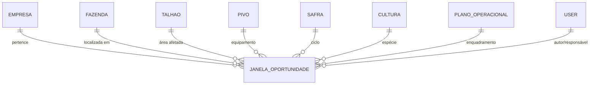
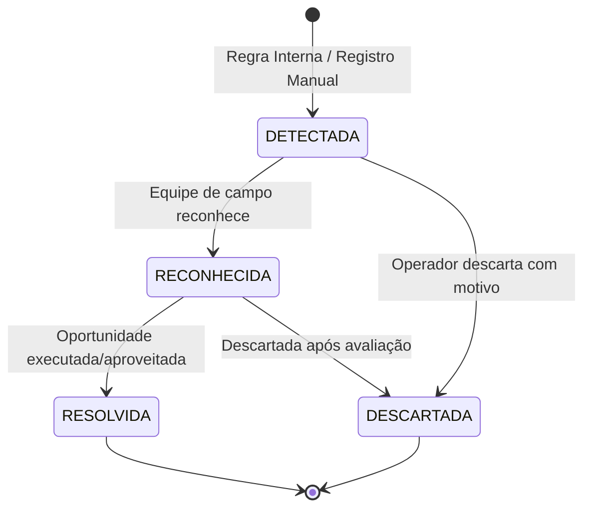

# Fase 4.2 — Módulo de Janelas de Oportunidade Operacional

Este documento detalha as especificações técnicas, regras de negócio, ciclo de vida e endpoints do módulo de **Janelas de Oportunidade** do Cockpit de Pivôs.

---

## 1. Visão Geral e Objetivos

O módulo de Janelas de Oportunidade provê inteligência agronômica e tarifária em tempo real para os operadores e gestores agrícolas. Ele monitora parâmetros operacionais e identifica intervalos ideais para ações de alto impacto econômico e produtivo, tais como:

1. **Aproveitamento de Tarifas Elétricas Fora de Ponta:** Redução drástica do custo de energia ligando pivôs prioritariamente no horário noturno ou fins de semana.
2. **Janelas Ótimas de Irrigação:** Irrigação em horários com menor evapotranspiração (vento reduzido e menor temperatura).
3. **Janelas Ideais de Plantio e Tratos:** Períodos com umidade de solo e previsão meteorológica propícia.
4. **Planejamento de Manutenção Preventiva:** Intervalos entre ciclos de irrigação para intervenção mecânica e elétrica sem estresse hídrico na cultura.

---

## 2. Modelo de Dados (`JanelaOportunidade`)

A entidade central está localizada em `backend/apps/operations/models.py`.

### 2.1 Enumerações de Domínio

| Enumerador | Opções | Descrição |
| :--- | :--- | :--- |
| **`TipoOportunidade`** | `TARIFA_NOTURNA`, `PLANTIO_IDEAL`, `IRRIGACAO_OTIMA`, `COLHEITA_PREVISTA`, `MANUTENCAO_PREVENTIVA`, `OUTRO` | Tipo do benefício ou janela operacional. |
| **`PrioridadeOportunidade`** | `BAIXA`, `MEDIA`, `ALTA`, `CRITICA` | Nível de urgência e impacto financeiro/produtivo. |
| **`SituacaoOportunidade`** | `DETECTADA`, `RECONHECIDA`, `RESOLVIDA`, `DESCARTADA` | Ciclo de vida da recomendação. |
| **`OrigemOportunidade`** | `MANUAL`, `REGRA_INTERNA`, `INTEGRACAO_EXTERNA` | Origem do registro ou gatilho gerador. |

---

## 3. Máquina de Estados e Ciclo de Vida

### Regras de Transição e Auditoria:
- **`DETECTADA` ➔ `RECONHECIDA`:** Registra o usuário em `reconhecido_por` e data em `reconhecido_em`.
- **`RECONHECIDA` / `DETECTADA` ➔ `RESOLVIDA`:** Registra `resolvido_por`, `resolvido_em` e marca `aproveitada = True`. Protegida contra exclusão acidental via API.
- **`DETECTADA` / `RECONHECIDA` ➔ `DESCARTADA`:** Exige preenchimento obrigatório do campo `motivo_descarte`, gravando `descartado_por` e `descartado_em`.
- Todas as transições geram um evento estruturado na tabela `AuditLog`.

---

## 4. Endpoints da API REST (`/api/v1/janelas/`)

| Método | Endpoint | Permissão | Descrição |
| :--- | :--- | :--- | :--- |
| `GET` | `/api/v1/janelas/` | Autenticado | Listagem com filtros de fazenda, pivô, status, prioridade, vencimento e texto. |
| `POST` | `/api/v1/janelas/` | Operador / Gerente | Criação manual de nova janela de oportunidade. |
| `GET` | `/api/v1/janelas/{id}/` | Autenticado | Detalhes completos da oportunidade. |
| `PUT/PATCH` | `/api/v1/janelas/{id}/` | Operador / Gerente | Edição de justificativas e parâmetros operacionais. |
| `POST` | `/api/v1/janelas/{id}/reconhecer/` | Campo / Gerente | Confirmação da ciência pela equipe operacional. |
| `POST` | `/api/v1/janelas/{id}/resolver/` | Campo / Gerente | Conclusão e registro do aproveitamento da oportunidade. |
| `POST` | `/api/v1/janelas/{id}/descartar/` | Campo / Gerente | Descarte com envio de motivo em payload JSON. |
| `POST` | `/api/v1/janelas/avaliar-regras/` | Gestor / Admin | Gatilho para processamento do motor de regras automáticas. |
| `GET` | `/api/v1/janelas/metricas/` | Autenticado | Contadores agrupados por status, prioridade e economia estimada (R$). |

---

## 5. Interface Web e Mobile

- **Web Cockpit (`src/routes/janelas-de-oportunidade.tsx`):** Grid gerencial com cartões categorizados por prioridade, filtros rápidos, contadores de oportunidade e modais interativos para resolução (`OpportunityResolveModal.tsx`) e descarte (`OpportunityDiscardModal.tsx`).
- **Aplicativo Mobile (`Mobile/src/screens/OpportunitiesScreen.tsx`):** Visualização de oportunidades ativas com capacidade de reconhecimento e resolução direta no campo, sincronizável via fila offline.
