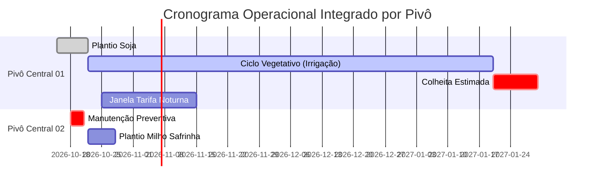

# Fase 4.3 — Calendário Operacional Integrado

Este documento estabelece os requisitos, arquitetura de dados e visão cronológica integrada do **Calendário Operacional** do Cockpit de Pivôs.

---

## 1. Visão Geral e Propósito

O **Calendário Operacional** unifica a dimensão temporal de todos os eventos agronômicos e operacionais da fazenda, permitindo que a liderança agrícola e os operadores de pivô visualizem em uma linha do tempo única:

1. **Ciclos de Cultivo:** Janelas de plantio, desenvolvimento vegetativo e colheita por talhão e pivô central.
2. **Eventos e Lâminas de Irrigação:** Histórico de irrigações executadas e irrigações agendadas com lâminas (mm).
3. **Janelas de Oportunidade:** Períodos de tarifa reduzida, paradas planejadas para manutenção e janelas meteorológicas ideais.
4. **Conflitos Operacionais:** Sobreposição indevida de ciclos no mesmo pivô ou concorrência excessiva de demanda hídrica/elétrica entre pivôs da mesma rede de bombeamento.

---

## 2. Estrutura Temporal e Eventos Mapeados

### Tipos de Itens no Calendário

| Categoria | Origem no Backend | Atributos Críticos |
| :--- | :--- | :--- |
| **`PLANO_PLANTIO`** | `PlanoOperacional.data_plantio` | Data inicial, cultura, talhão/pivô, variedade e área (ha). |
| **`PLANO_COLHEITA`** | `PlanoOperacional.data_colheita_prevista` | Data final prevista, estimativa de produtividade e dias de ciclo restante. |
| **`JANELA_TARIFA`** | `JanelaOportunidade (TARIFA_NOTURNA)` | Início, fim, economia estimada (R$) e pivôs associados. |
| **`IRRIGACAO_EXEC`** | `RegistroIrrigacao` | Data/hora de início e fim, lâmina aplicada (mm), usuário/origem. |
| **`MANUTENCAO`** | `JanelaOportunidade (MANUTENCAO_PREVENTIVA)` | Intervalo de parada recomendada para revisão de bombas e aspersores. |

---

## 3. Endpoints e Consumo de Dados

O frontend consome o calendário através de agregações eficientes no backend:

- **`GET /api/v1/planos/calendario/`**: Retorna eventos formatados no intervalo especificado por parâmetros de query:
  - `data_inicio`: Limite inferior (ISO-8601).
  - `data_fim`: Limite superior (ISO-8601).
  - `fazenda`: Filtro por ID da fazenda.
  - `safra`: Filtro por safra específica.
  - `cultura`: Filtro por cultura agrícola.
  - `status`: Situação do plano operacional (`RASCUNHO`, `PLANEJADO`, `EM_ANDAMENTO`, etc.).

---

## 4. Componente Visual e Interação (`PlanningCalendar.tsx`)

O componente em `src/components/planejamento/PlanningCalendar.tsx` oferece:
- **Visão Mensal e Anual:** Navegação fluida entre meses e anos com seleção de safra vigente.
- **Filtros Dinâmicos:** Filtros cruzados por fazenda, cultura, safra e status.
- **Badges Semânticos:** Cores diferenciadas por cultura e status do plano (Rascunho, Planejado, Em Andamento, Concluído).
- **Drill-down:** Ao clicar em um evento, o modal de detalhes do plano operacional (`PlanDetailModal.tsx`) é acionado para exibição e edição rápida.
