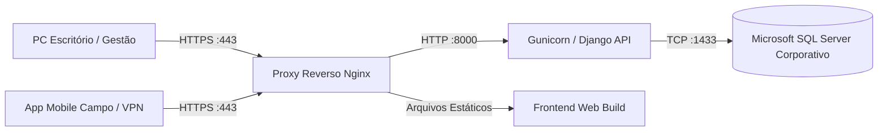

# Manual de Implantação On-Premises — Cockpit de Pivôs

## 1. Visão Geral da Infraestrutura Própria

Este documento descreve os procedimentos completos para instalação, execução e manutenção do **Cockpit de Pivôs** na infraestrutura de servidores locais da empresa (**on-premises**), sem dependência de serviços de nuvem de terceiros.

A infraestrutura é composta por:
1. **Servidor Web / Borda:** Nginx atuando como proxy reverso, terminador SSL (HTTPS) e distribuidor estático.
2. **Servidor de Aplicação:** Container Docker ou serviço systemd/Windows Service executando a API Django via Gunicorn / Uvicorn.
3. **Servidor de Banco de Dados:** Instância corporativa existente do **Microsoft SQL Server** (2016, 2019 ou 2022).
4. **Clientes:** Navegadores corporativos nos PCs da fazenda/escritório e aplicativo móvel (Android/iOS) conectado à rede local ou VPN corporativa.

---

## 2. Requisitos de Sistema

- **Sistema Operacional do Servidor:** Linux (Ubuntu 22.04 LTS / Debian 12 / Rocky Linux 9) ou Windows Server 2019/2022.
- **Hardware Recomendado:**
  - CPU: 4 núcleos ou superior.
  - Memória RAM: 8 GB (mínimo 4 GB dedicados à aplicação).
  - Armazenamento: 50 GB SSD (espaço para banco de dados, logs e backups).
- **Rede:** IP estático na rede interna e certificado SSL corporativo (ou gerado internamente pela AC da empresa).
- **Portas Necessárias:**
  - `80/TCP` (Redirecionamento HTTP -> HTTPS).
  - `443/TCP` (Acesso web seguro e endpoint da API para PC e Mobile).
  - `1433/TCP` (Comunicação interna exclusiva entre Servidor de Aplicação e SQL Server).

---

## 3. Topologia de Rede e Comunicação



---

## 4. Variáveis de Ambiente (`.env`)

No diretório raiz da instalação do backend, copie `.env.example` para `.env` e configure:

```ini
# Configurações do Ambiente
DEBUG=False
SECRET_KEY=sua-chave-secreta-corporativa-gerada-aleatoriamente
ALLOWED_HOSTS=cockpit.fazenda.local,192.168.1.100,localhost

# Banco de Dados Microsoft SQL Server
DB_ENGINE=mssql
DB_NAME=CockpitPivosDB
DB_USER=sa_cockpit
DB_PASSWORD=SenhaForteCorporativa123!
DB_HOST=192.168.1.10
DB_PORT=1433
DB_ODBC_DRIVER=ODBC Driver 18 for SQL Server

# CORS & Segurança
CORS_ALLOWED_ORIGINS=https://cockpit.fazenda.local,http://localhost:8080
```

---

## 5. Procedimento de Instalação via Docker Compose

### 5.1 Arquivo `deploy/docker-compose.yml`

O projeto inclui orquestração automatizada via Docker Compose:

```bash
# 1. Clonar ou copiar o projeto para o servidor
cd /opt/cockpit-de-pivos

# 2. Configurar o arquivo de ambiente
cp .env.example .env
nano .env

# 3. Subir os serviços
docker compose -f deploy/docker-compose.yml up -d --build

# 4. Executar as migrações do banco de dados
docker compose -f deploy/docker-compose.yml exec backend python manage.py migrate

# 5. Criar usuário administrador inicial
docker compose -f deploy/docker-compose.yml exec backend python manage.py createsuperuser
```

---

## 6. Procedimento de Backup e Restauração do SQL Server

### 6.1 Backup Diário Automatizado

Recomenda-se agendar via SQL Server Agent ou cron job:

```sql
BACKUP DATABASE [CockpitPivosDB]
TO DISK = N'/backups/CockpitPivosDB_Full_' + REPLACE(CONVERT(VARCHAR(20), GETDATE(), 120), ':', '-') + '.bak'
WITH FORMAT, INIT, COMPRESSION, STATS = 10;
```

### 6.2 Restauração de Emergência (Disaster Recovery)

```sql
ALTER DATABASE [CockpitPivosDB] SET SINGLE_USER WITH ROLLBACK IMMEDIATE;
RESTORE DATABASE [CockpitPivosDB]
FROM DISK = N'/backups/CockpitPivosDB_Full_UltimoValido.bak'
WITH REPLACE, RECOVERY;
ALTER DATABASE [CockpitPivosDB] SET MULTI_USER;
```

---

## 7. Procedimentos de Atualização e Rollback

1. **Atualização da Aplicação:**
   - Obter a versão homologada dos fontes.
   - `docker compose -f deploy/docker-compose.yml build`
   - `docker compose -f deploy/docker-compose.yml exec backend python manage.py migrate`
   - `docker compose -f deploy/docker-compose.yml up -d --no-deps backend frontend`
2. **Rollback:**
   - Caso uma migração falhe, restaure a tag anterior dos containers Docker e reverta o backup do banco de dados correspondente à versão.
