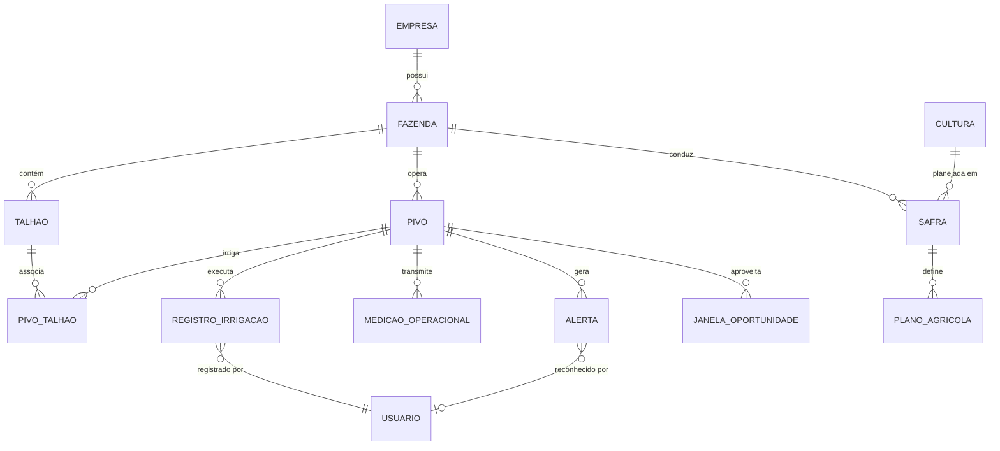

# Modelo de Domínio Agrícola — Cockpit de Pivôs

## 1. Visão Geral do Domínio

O domínio agrícola do **Cockpit de Pivôs** organiza as operações de irrigação e planejamento em torno da estrutura fundiária (Empresa > Fazenda > Talhão) e dos equipamentos de irrigação mecanizada (**Pivôs Centrais**).

---

## 2. Dicionário de Entidades e Unidades de Medida

### 2.1 Estrutura Fundiária e Equipamentos

#### `Empresa`
- **Identificação:** `id` (UUID), `codigo`, `razao_social`, `nome_fantasia`, `cnpj`.
- **Controle:** `ativo` (bool), `criado_em`, `atualizado_em`.

#### `Fazenda`
- **Identificação:** `id` (UUID), `empresa_id` (FK), `nome`, `codigo`.
- **Localização:** `municipio`, `uf`, `latitude` (graus decimais), `longitude` (graus decimais).
- **Dimensão:** `area_total_ha` (hectares, precisão 2 casas decimais).

#### `Talhão`
- **Identificação:** `id` (UUID), `fazenda_id` (FK), `codigo`, `nome`.
- **Dimensões:** `area_ha` (hectares), `geometria_geojson` (polígono do perímetro, opcional).

#### `Pivo` (Pivô Central de Irrigação)
- **Identificação:** `id` (UUID), `fazenda_id` (FK), `codigo` (ex: "PIV-01"), `nome` (ex: "Pivô Sede Norte").
- **Coordenadas Centrais:** `latitude_centro`, `longitude_centro` (centro do pivô).
- **Especificações de Engenharia:**
  - `raio_metros` (metros, ex: 450.0 m)
  - `area_irrigada_ha` (hectares, ex: 63.62 ha) — calculada ou ajustada por ângulo de giro
  - `vazao_nominal_m3h` (metros cúbicos por hora, ex: 280.0 m³/h)
  - `pressao_nominal_bar` (bar, ex: 3.5 bar)
  - `velocidade_100_percent_mh` (metros por hora no último lance a 100% do percentímetro)
  - `angulo_inicial_graus` / `angulo_final_graus` (para pivôs setoriais, default 0° a 360°)
- **Estado Operacional em Tempo Real:**
  - `status_operacional`: `PARADO`, `IRRIGANDO`, `FERTIRRIGANDO`, `MANUTENCAO`, `FALHA`
  - `angulo_atual_graus` (0° a 360°, onde 0°/360° aponta para o Norte geográfico)
  - `sentido_rotacao`: `HORARIO`, `ANTI_HORARIO`, `ESTACIONARIO`
  - `percentimetro_atual` (0 a 100%)
  - `lamina_atual_mm` (lâmina d'água aplicada estimada, em milímetros)
  - `pressao_atual_bar` (leitura atual de pressão na base ou extremidade)
  - `tensao_eletrica_v` (volts, ex: 380V)
  - `ultima_comunicacao` (timestamp UTC)
- **Relação com Talhões:** Mapeamento Many-to-Many via `PivoTalhao`, cobrindo as áreas atendidas.

---

### 2.2 Culturas e Planejamento Agrícola

#### `Cultura`
- **Identificação:** `id` (UUID), `nome` (ex: Soja, Milho, Algodão, Feijão), `variedade`, `coeficiente_kc_padrao`.
- **Ciclo:** `dias_ciclo_estimado` (dias).

#### `Safra`
- **Identificação:** `id` (UUID), `empresa_id` (FK), `nome` (ex: "Safra 2024/2025 - Verão"), `data_inicio`, `data_fim`.

#### `PlanoOperacional`
- **Identificação:** `id` (UUID), `safra_id` (FK), `pivo_id` (FK), `cultura_id` (FK).
- **Datas:** `data_plantio`, `data_colheita_prevista`, `data_colheita_real`.
- **Metas de Lâmina:** `lamina_total_planejada_mm`, `lamina_acumulada_realizada_mm`.
- **Status:** `PLANEJADO`, `EM_ANDAMENTO`, `CONCLUIDO`, `CANCELADO`.

---

### 2.3 Operações de Campo e Sincronização Resiliente

#### `RegistroIrrigacao`
- **Identificação:** `id` (UUID no servidor), `client_op_id` (UUID v4 gerado no mobile para idempotência).
- **Associação:** `pivo_id` (FK), `plano_operacional_id` (FK opcional), `operador_id` (FK).
- **Período:** `inicio_em` (datetime), `fim_em` (datetime nullable para irrigações ativas).
- **Parâmetros Operados:**
  - `percentimetro` (1% a 100%)
  - `lamina_aplicada_mm` (milímetros)
  - `angulo_inicial_graus`, `angulo_final_graus`
  - `sentido`: `HORARIO` ou `ANTI_HORARIO`
  - `hidrometro_inicial_m3`, `hidrometro_final_m3` (metros cúbicos)
  - `consumo_kwh` (quilowatts-hora)
  - `tarifa_aplicada`: `PONTA`, `FORA_PONTA`, `RESERVADO`
- **Metadados de Sincronização:**
  - `origem`: `WEB`, `MOBILE_OFFLINE`, `TELEMETRIA`
  - `sincronizado_em` (timestamp UTC no servidor)
  - `observacoes` (texto livre preenchido pelo operador de campo)

#### `MedicaoOperacional` (Telemetria & Leituras de Campo)
- **Campos:** `id` (UUID), `pivo_id` (FK), `timestamp`, `angulo_graus`, `pressao_bar`, `status`, `tensao_v`, `corrente_a`, `vazao_m3h`.

#### `Alerta`
- **Campos:** `id` (UUID), `pivo_id` (FK), `tipo`: `PRESSAO_BAIXA`, `QUEDA_ENERGIA`, `DESALINHAMENTO`, `FALHA_COMUNICACAO`, `DESVIO_LAMINA`.
- **Severidade:** `INFO`, `ATENCAO`, `CRITICO`.
- **Ciclo de Vida:** `gerado_em`, `reconhecido_em`, `reconhecido_por` (FK), `resolvido_em`.

#### `JanelaOportunidade`
- **Premissa Técnica:** Período tarifário e climático favorável para ligar o pivô (ex: Tarifa Verde Fora de Ponta ou Madrugada sem chuva prevista).
- **Campos:** `pivo_id` (FK), `inicio_previsto`, `fim_previsto`, `motivo` ("Tarifa Reduzida", "Demanda Hídrica Crítica"), `economia_estimada_reais`.

---

## 3. Regras de Validação e Consistência Agronômica

1. **Unicidade de Código:** O código do pivô (`codigo`) deve ser único por Fazenda.
2. **Giro do Pivô:** O ângulo deve estar sempre restrito ao intervalo `[0.00, 360.00]`.
3. **Percentímetro:** Deve estar estritamente no intervalo `[1, 100]`.
4. **Cálculo da Lâmina:** A lâmina teórica é função direta da vazão, da área irrigada e do tempo de giro (relação inversamente proporcional à velocidade do percentímetro).
5. **Idempotência de Operações:** O campo `client_op_id` é chave única estrita para evitar que falhas de conexão multipliquem registros de irrigação ou apontamentos no banco central.
