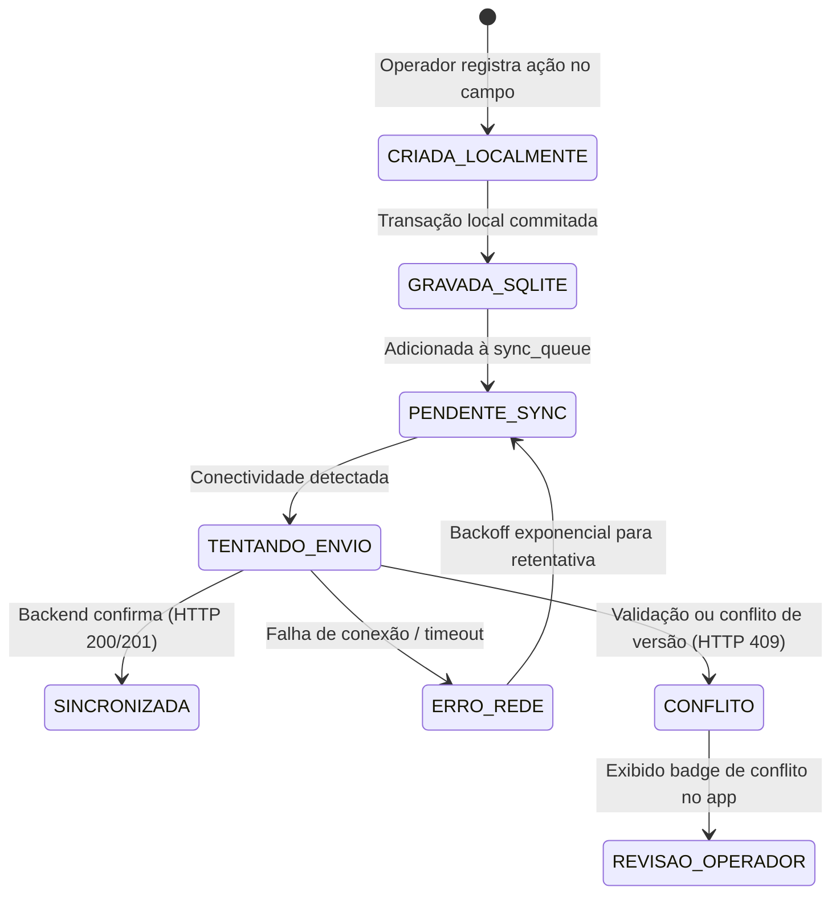

# Estratégia de Operação Offline e Sincronização Resiliente

## 1. Princípios de Funcionamento no Campo

Em ambientes agrícolas, a conectividade celular (4G/3G) é frequentemente intermitente ou inexistente no meio do talhão. O aplicativo móvel do **Cockpit de Pivôs** é projetado segundo a filosofia **Offline-First Operacional**:

1. **Dados em Cache Local:** Ao iniciar a jornada com conexão (na sede da fazenda ou via Wi-Fi do escritório), o app baixa o catálogo atualizado de pivôs, culturas, fazendas e parâmetros vigentes para um banco **SQLite** local criptografado.
2. **Registro de Ações em Campo:** Apontamentos operacionais (início/fim de irrigação, leitura de horímetro/hidrômetro, anotações de campo) são salvos de forma síncrona e atômica no SQLite local.
3. **Fila de Sincronização (Outbox Queue):** Toda mutação offline gera um registro na tabela local `sync_queue` com estado `PENDING` e um identificador globalmente único `client_op_id` (UUID v4).
4. **Despacho Idempotente:** Quando a conexão com a API é restabelecida, a engine de sincronização despacha os itens em ordem cronológica (FIFO por entidade). O backend verifica a existência prévia de `client_op_id`. Se já tiver sido processado, responde com sucesso (HTTP 200) sem duplicar registros.

---

## 2. Diagrama de Estados da Operação no Mobile



---

## 3. Protocolo de Sincronização da API

### Endpoint de Sincronização em Lote (`/api/v1/sync/push/`)

O aplicativo envia as operações pendentes em lotes ou individualmente:

```json
{
  "client_device_id": "MOBILE-SAMSUNG-A54-OPERADOR1",
  "batch_timestamp": "2026-10-11T14:30:00Z",
  "operations": [
    {
      "client_op_id": "a3b89f21-7890-4c12-a1b2-98c765432101",
      "entity": "registro_irrigacao",
      "action": "CREATE",
      "occurred_at": "2026-10-11T14:15:22Z",
      "payload": {
        "pivo_id": "f47ac10b-58cc-4372-a567-0e02b2c3d479",
        "percentimetro": 85,
        "lamina_aplicada_mm": 6.8,
        "sentido": "HORARIO",
        "observacoes": "Pivô ligado após verificação de pressão na base."
      }
    }
  ]
}
```

### Resposta do Servidor:

```json
{
  "status": "COMPLETED",
  "processed_at": "2026-10-11T14:30:02Z",
  "results": [
    {
      "client_op_id": "a3b89f21-7890-4c12-a1b2-98c765432101",
      "status": "SUCCESS",
      "server_id": "d981240c-2178-4cf2-8341-998877665544",
      "message": "Registro de irrigação processado com sucesso."
    }
  ]
}
```

---

## 4. Política de Resolução de Conflitos

1. **Adição de Registros Históricos:** (Ex: Leituras e Irrigações) Não geram conflito destrutivo, pois são eventos imutáveis com timestamp próprio.
2. **Atualização de Estado de Pivôs:** Utiliza a estratégia **Server Timestamp & Last Valid State**:
   - Cada pivô possui o campo `updated_at`.
   - Se o operador tentar atualizar uma configuração de pivô com base em uma versão anterior à vigente no servidor, o servidor rejeita com código de conflito e retorna o estado atualizado para reconciliação assistida.
3. **Falhas Temporárias:** Erros 5xx ou Timeout nunca descartam a fila; o app mantém na fila local e tenta novamente quando o heartbeat da API responder com status de saúde favorável (`/api/v1/health/`).
